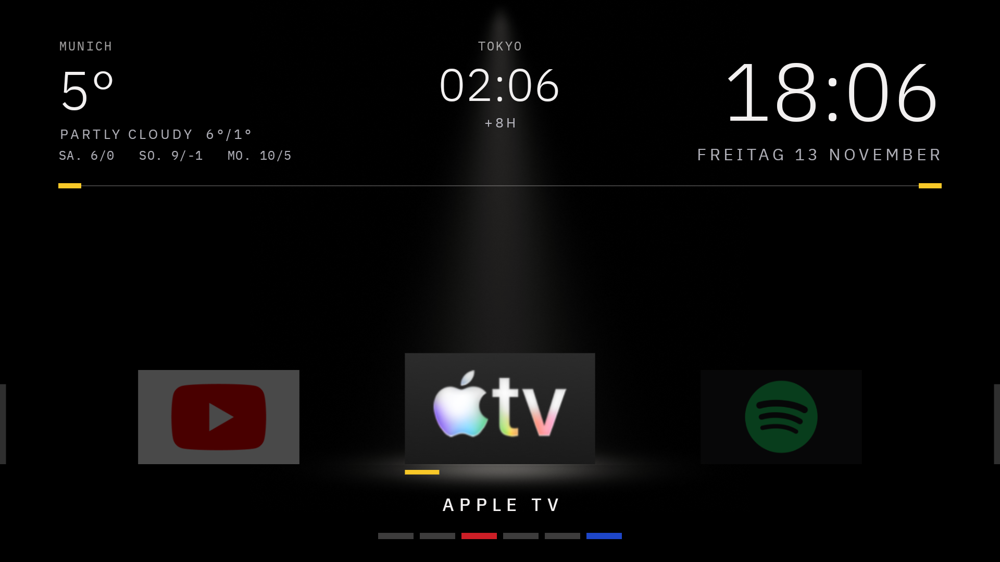

# RietveldTV

A minimal, ad-free home screen for Android TV / Google TV.
Black room, one spotlight, flat rectangular app icons, a few quiet widgets. Inspired by Gerrit Rietveld's *Red and Blue Chair* and modernist web design.



- **No ads, no recommendations, no accounts, no tracking.** It only shows the apps you list.
- **Flat icons under a spotlight.** Hard-edged rectangles in each app's own colours. The focused app is lit and gets a small yellow end-cut tab, like the painted ends of the Red and Blue Chair; the rest sink into the dark.
- **Widgets:** local clock and date, extra clocks in other time zones, and weather with a short forecast.
- **Configured with one JSON file.** Edit it by hand or [let Claude do it](docs/CUSTOMIZE-WITH-CLAUDE.md).
- **No network access unless you add a weather widget.** No analytics, no third-party SDKs.


## Install

You need an Android TV / Google TV on the same Wi-Fi as your computer, and `adb` (`sudo apt install android-tools-adb`, or [platform-tools](https://developer.android.com/tools/releases/platform-tools)).

1. **Enable debugging on the TV.** Settings → Device Preferences → About → tap *Build* 7 times. Then Developer options → turn on *USB debugging* (and network/wireless debugging if offered).
2. **Find the TV's IP address** (Settings → Network, or your router's device list).
3. **Get the APK.** Download `RietveldTV.apk` from the [latest release](../../releases/latest), or build it: `./gradlew assembleDebug` (needs JDK 17+ and the Android SDK).
4. **Install:**
   ```bash
   scripts/install.sh 192.168.1.50 RietveldTV.apk
   ```
   Accept the "Allow debugging?" prompt on the TV the first time. Then press **Home** on the remote.

## Configure

The defaults are in [`app/src/main/assets/config.default.json`](app/src/main/assets/config.default.json). To change them, copy [`docs/config.example.json`](docs/config.example.json) to `config.json`, edit it, and send it to the TV:

```bash
scripts/push-config.sh 192.168.1.50 config.json
```

```json
{
  "apps": ["com.netflix.ninja", "com.google.android.youtube.tv", "com.spotify.tv.android"],
  "showSettings": true,
  "widgets": [
    { "type": "weather", "city": "Berlin", "position": "top-left", "days": 3 },
    { "type": "clock", "label": "Tokyo", "timezone": "Asia/Tokyo", "position": "top-center" },
    { "type": "clock", "position": "top-right" }
  ]
}
```

| Key | Meaning |
| --- | --- |
| `apps` | Package names, in display order. Only installed apps appear. Find a package with `adb shell pm list packages \| grep -i netflix`. |
| `showSettings` | Show the Settings tile at the end of the row. |
| `terminal` | The small typing line "> 5 apps ready" at the top-left (default `true`). It hides itself when a widget is placed top-left. |
| `widgets` | Any number of widgets, each with a `type` and an optional `position`. Types below. |

**Widgets**

Every widget takes a `position`: `top-right` (default), `top-center`, `top-left`, `bottom-left` or `bottom-right`. Widgets with the same position sit side by side in config order. Keep top widgets under about 130 dp tall so they stay above the rule line.

| Type | Options |
| --- | --- |
| `clock` | `label`, `timezone` (IANA id like `Asia/Tokyo`; omit for local time), `size` (`l`/`m`), `hour24` (default `true`), `date` |
| `weather` | `city` (looked up once) **or** `latitude` + `longitude`, `name` (label), `units` (`celsius`/`fahrenheit`), `days` (0–5). Data from [Open-Meteo](https://open-meteo.com) (no key, no account). Only the city name or the coordinates you configure are sent. |

Want a new widget? See [Add your own widget](docs/CUSTOMIZE-WITH-CLAUDE.md#add-a-widget). It is about 40 lines of Java.

## Customise with Claude

The whole look (colours, fonts, spotlight, glass, widgets) lives in two files. [This guide](docs/CUSTOMIZE-WITH-CLAUDE.md) shows how to change them by describing what you want to [Claude Code](https://claude.com/claude-code), with copy-paste prompts and a screenshot loop so Claude can check its own work on your TV.

## Troubleshooting

- **Home still opens the stock launcher.** Some TVs rank their own launcher or setup wizard higher. Pin ours with
  `adb shell cmd package set-home-activity --user 0 dev.oliver.home/.HomeActivity`.
  If that is not enough, disable the competing launcher (`adb shell pm disable-user --user 0 <package>`; list candidates with
  `adb shell pm query-activities --brief -a android.intent.action.MAIN -c android.intent.category.HOME`).
  Only disable what you need. On one Xiaomi TV the Google setup wizard (`com.google.android.tungsten.setupwraith`) had to go, and the TV restarted and turned debugging off, so re-enable it in Developer options afterwards.
- **Undo everything:** `scripts/restore.sh <tv-ip>` re-enables the stock launchers and removes the app.
- **Apps missing:** the package name in `apps` is wrong, or the app has no launcher entry. Check with `adb shell pm list packages`.
- **Debugging turned itself off after a reboot:** turn it back on in Developer options.

## Build

```bash
./gradlew assembleDebug        # app/build/outputs/apk/debug/app-debug.apk
```

Plain Android Views and Canvas, no AndroidX, no Compose, no dependencies. `minSdk 26`, tested on Android 14 (Xiaomi Mi TV, Google TV).

## Credits and licence

Code: MIT. Fonts: [IBM Plex](https://github.com/IBM/plex) under the SIL Open Font License 1.1 (see `app/src/main/assets/fonts/OFL.txt`). Weather data: [Open-Meteo](https://open-meteo.com).
Not affiliated with Google, Xiaomi, Apple, Netflix, Spotify or YouTube; their names and logos belong to their owners.
